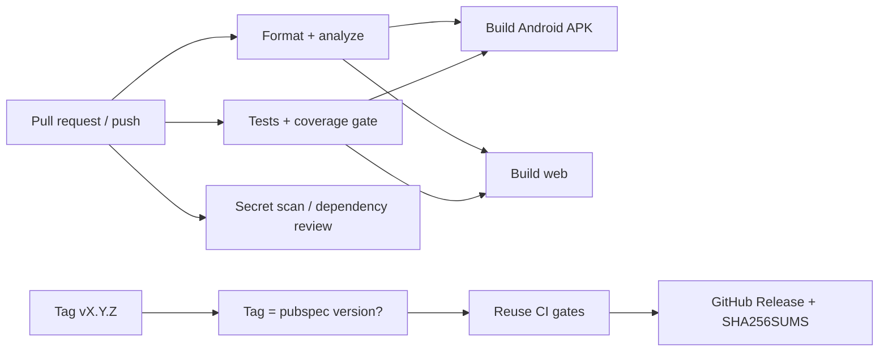

# Flutter CI Quality Template

[](https://github.com/OWNER/REPO/actions/workflows/ci.yml)
[](https://github.com/OWNER/REPO/actions/workflows/security.yml)

A reusable Flutter starter that treats **delivery** as part of the product: a small,
cleanly layered app (GetX) wrapped in a CI/CD pipeline you can copy into a real project.

The app is intentionally small. The point is everything around it: the quality gates,
the test reporting, the build validation, the secret handling and the release flow.

## What you get

| Area | What's in the box |
| --- | --- |
| **Code quality** | Strict analyzer (`strict-casts`, `strict-inference`, `strict-raw-types`), curated lints, enforced formatting, `--fatal-infos` |
| **Tests** | Unit tests (repository, controller with mocks), widget tests, an app-boot smoke test |
| **Reporting** | Pass/fail table and per-file coverage in the GitHub job summary, raw JSON + lcov uploaded as artifacts |
| **Coverage gate** | Build fails below a configurable threshold (default 80%) |
| **Build validation** | Release APK and web build on every PR, gated behind format/analyze/test |
| **Dependencies** | Dependabot (pub + GitHub Actions), dependency review on PRs, weekly outdated report |
| **Secrets** | gitleaks scan over full history, hardened `.gitignore`, least-privilege workflow permissions, [secrets guide](docs/SECRETS.md) |
| **Releases** | Tag-driven GitHub Release with checksums; tag must match `pubspec.yaml`; **no signing credentials involved** |

## Pipeline



Builds only start after format, analysis and tests pass, so failures surface in
seconds instead of after a 10-minute Gradle build.

## Architecture

```
lib/
├── app/                      # composition root: theme, routes, global bindings
└── features/tasks/
    ├── domain/               # entities + repository interface (pure Dart)
    ├── data/                 # repository implementations
    └── presentation/         # GetX controller, binding, page
```

Dependencies point inward: `presentation → domain ← data`. Controllers depend on the
`TaskRepository` **interface**, which is why they are tested with a mock and no widget
tree. See [docs/ARCHITECTURE.md](docs/ARCHITECTURE.md) and the
[state management decision record](docs/adr/0001-state-management.md).

## Quick start

```bash
# 1. One-time: generate android/ and web/ platform folders, then commit them
./scripts/bootstrap.sh --org com.yourcompany

# 2. Run the same gates CI runs
make check

# 3. Run the app
flutter run
```

`make check` runs formatting, analysis, tests, and the coverage gate. If it passes
locally, CI should pass.

## Using this as a template

1. Click **Use this template** (or copy the files into your project).
2. Replace `OWNER/REPO` in the badges above.
3. Run `scripts/bootstrap.sh` and commit `android/` and `web/`.
4. Set the coverage threshold: `COVERAGE_THRESHOLD` in `.github/workflows/ci.yml`.
5. In **Settings → Branches**, require the `CI` checks before merging.
6. Replace the `tasks` feature with your own, keeping the layering.

## Releasing

```bash
# bump `version:` in pubspec.yaml to 1.2.3+4, merge, then:
git tag v1.2.3
git push origin v1.2.3
```

The workflow verifies the tag matches `pubspec.yaml`, re-runs every CI gate, builds, and
publishes a GitHub Release with `SHA256SUMS.txt`. Artifacts are **unsigned** by design;
[docs/SECRETS.md](docs/SECRETS.md) covers adding signing safely when you need it.

## Repository layout

```
.github/workflows/   ci.yml · security.yml · release.yml
.github/             dependabot.yml · pull_request_template.md
scripts/             ci_report.py (test summary + coverage gate) · bootstrap.sh
docs/                ARCHITECTURE.md · SECRETS.md · adr/
```

## License

Add your preferred license (MIT is a common choice for templates).
# flutter-ci-quality-template
