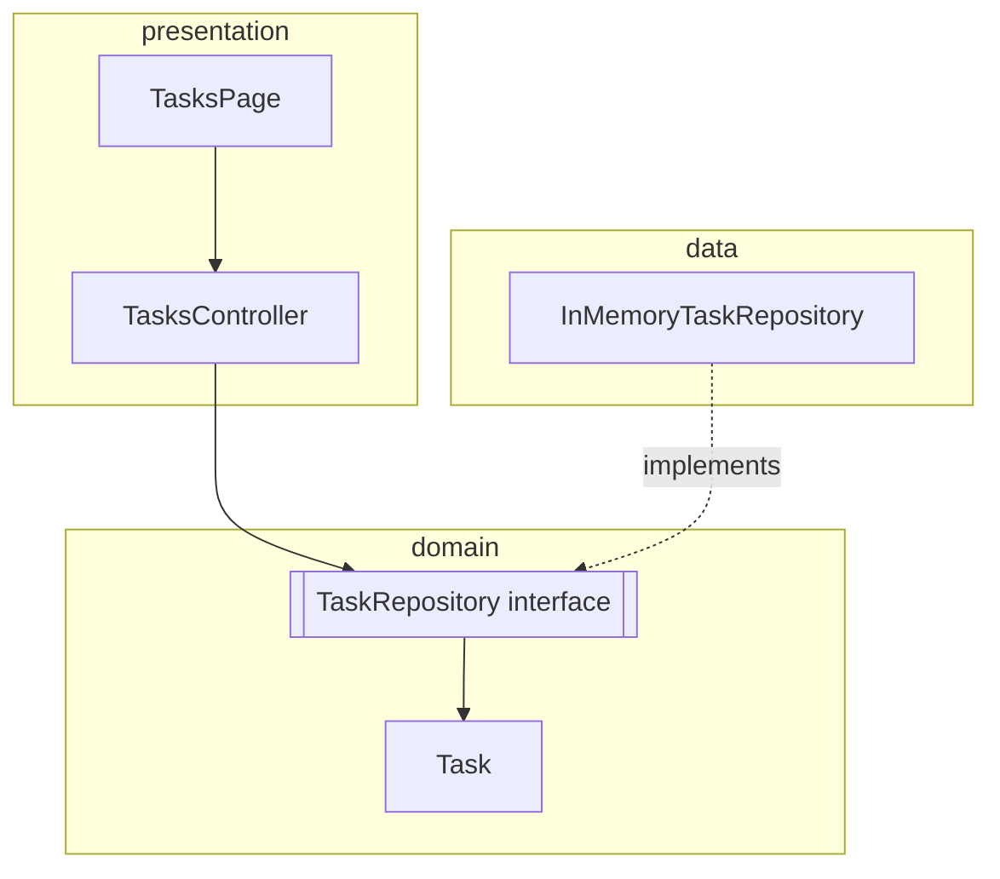

# Architecture

## Layers

| Layer | Contains | May depend on |
| --- | --- | --- |
| `domain` | Entities, repository interfaces, domain exceptions | Dart only (plus `foundation` for `@immutable`) |
| `data` | Repository implementations | `domain` |
| `presentation` | Controllers, bindings, widgets | `domain` |
| `app` | Theme, routes, composition root | everything |

`presentation` never imports `data`. The only place an interface is bound to an
implementation is `app/bindings/initial_binding.dart`.

## Request flow

1. `GetMaterialApp` resolves `/tasks` and runs `TasksBinding`.
2. `TasksBinding` lazily creates `TasksController`, injecting `TaskRepository`
   (registered globally in `InitialBinding`).
3. The controller loads data in `onInit` and exposes `Rx` state.
4. Widgets wrap reads in `Obx`, so only the affected subtree rebuilds.

## Error handling

Controllers never let repository exceptions escape into the UI. A single `_run`
helper converts failures into a user-facing `errorMessage` and a boolean result, and
the page renders that message in a dismissible banner. Input validation exists at two
levels: the controller (fast UX feedback) and the repository (data integrity).

## Testing strategy

| Level | Target | Technique |
| --- | --- | --- |
| Unit | Repository | Real implementation, no mocks |
| Unit | Controller | `mocktail` mock of `TaskRepository`; no widget tree |
| Widget | `TasksPage` | Real controller + in-memory repository, assert on UI |
| Smoke | `App` | Boots the real app through routing and bindings |

Controller tests assert behaviour (state transitions, error messages, repository
interactions), not implementation details, so refactors don't break them.

## Extending

To add a feature, create `lib/features/<name>/{domain,data,presentation}`, register its
repository in `InitialBinding`, add a route in `AppPages`, and give the page its own
binding. To swap persistence, implement `TaskRepository` and change one line in
`InitialBinding`.
